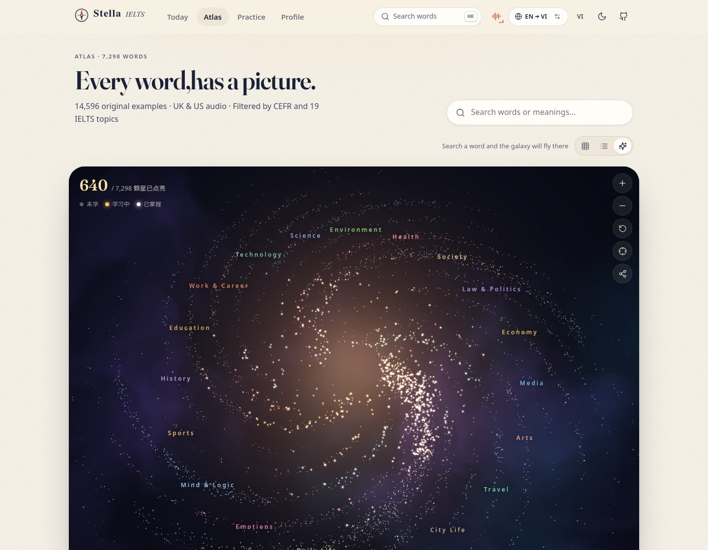

<div align="center">


# Stella

### ✨ One word, one canvas. Light up your stars. ✨
*Mỗi từ một bức tranh. Thắp sáng hành trình IELTS.*

<p align="center">
  <b>7,298 Illustrated Words</b> · <b>Native UK/US Audio</b> · <b>FSRS Spaced Repetition</b> · <b>3D WebGL Galaxy</b> · <b>Human-Edited Vietnamese Insights</b>
</p>

[](https://lexastra.zhugez.workers.dev)
[](https://github.com/zhugez/stella)

<br/>

[](LICENSE)
[](CONTENT_LICENSE.md)
[](https://pnpm.io/)
[](https://oxc.rs/)
[](https://www.typescriptlang.org/)
[](https://react.dev/)
[](https://github.com/open-spaced-repetition/ts-fsrs)

<br/>

[**Live Demo**](https://lexastra.zhugez.workers.dev) · [**Brandkit & Design System**](BRANDKIT.md) · [**Explore Dataset**](data/) · [**Roadmap**](#-roadmap-the-4-skill-ielts-ecosystem)

</div>

---

## 🌟 Overview

**Stella** is an open-source, local-first IELTS vocabulary and skill ecosystem designed around visual learning, scientific spaced repetition, and authentic human explanation. 

Instead of dry dictionary definitions or artificial AI-generated templates, Stella pairs every word with an original painting, dual UK/US native audio recordings, real exam collocations, and practical Vietnamese scoring tips written by experienced language learners.

<table>
  <tr>
    <td width="50%"></td>
    <td width="50%"></td>
  </tr>
  <tr>
    <td align="center"><b>Illustrated Atlas</b>: 7,298 hand-curated paintings & context</td>
    <td align="center"><b>3D WebGL Galaxy</b>: Interactive celestial map across 19 topics</td>
  </tr>
</table>

---

## 💎 Key Highlights

### 🎨 Visual-First Vocabulary (7,298 Words)
- Every single vocabulary item includes a dedicated, context-rich painting visualizing the exact scenario used in example sentences.
- Filter effortlessly across **6 CEFR levels (A1 to C2)** and **19 high-yield IELTS topic clusters** (Education, Technology, Environment, Society, Law & Politics, Economy, etc.).

### ✍️ Human Editorial Vietnamese Voice (No AI Clichés)
- Definitions, everyday sentences, and academic IELTS examples translated with natural cadence and realistic pauses.
- **Strict Anti-AI Voice Standard:** Zero robotic buzzwords (*"mở khóa", "đào sâu", "bức tranh tổng thể", "mang tính then chốt", "trong thế giới ngày nay", "hơn nữa", "bên cạnh đó"*).
- Practical examiner notes: what native speakers actually say, prepositions to watch out for, and natural collocations for IELTS Writing Task 2 and Speaking.

### 🧠 Modern FSRS Spaced Repetition
- Powered by the **Free Spaced Repetition Scheduler (FSRS)** — the state-of-the-art memory algorithm adopted by modern Anki.
- Accurately predicts memory stability ($S$) and retrievability ($R$), scheduling reviews right before decay occurs to eliminate burnout.

### 🌌 Interactive 3D WebGL Galaxy
- All 7,298 words mapped as stars across celestial arms.
- Drag to orbit, scroll to zoom, click stars to inspect cards.
- Star brightness reflects personal mastery: newly learned words shine bright in gold.

### ⌨️ Typing Studio & Dictation
- Build tactile finger memory through 3 interactive typing modes:
  - **Word:** Identify the painting and type the target word.
  - **Sentence:** Transcribe full sentences to absorb natural grammar and rhythm.
  - **Dictation:** Listen to native audio and write out the exact words.

### 🌧️ Focus Soundscapes
- Built-in ambient background soundscapes (Rainy Library, Starlight Music, Morning Coast, Forest, Evening Fireplace, Quiet Cafe).
- Intelligent ducking: background audio automatically softens whenever pronunciation audio plays.

### 🛡️ 100% Local-First & Private
- Zero sign-ups, zero tracking, zero passwords.
- All learning history lives in your device's browser and can be exported as a clean JSON backup at any time.

---

## 🛠️ Modern Tech Stack

- **Framework:** [React 19](https://react.dev/) + [TypeScript 5.9](https://www.typescriptlang.org/)
- **Bundler:** [Vite 6](https://vite.dev/)
- **Package Manager:** [pnpm 12](https://pnpm.io/)
- **Tooling & Linting:** [Oxc (oxlint)](https://oxc.rs/) — sub-20ms ultra-fast Rust-based static analysis
- **Spaced Repetition:** [`ts-fsrs`](https://github.com/open-spaced-repetition/ts-fsrs)
- **3D Graphics:** WebGL2 custom particle rendering engine
- **Typography:** `Fraunces` Variable Serif + `Plus Jakarta Sans`
- **Hosting:** [Cloudflare Workers](https://workers.cloudflare.com/) with Edge Static Assets & Audio Proxy

---

## 🚀 Getting Started

### Prerequisites
- [Node.js](https://nodejs.org/) v20+
- [pnpm](https://pnpm.io/installation) v10+

### Installation & Development

```bash
# Clone the repository
git clone https://github.com/zhugez/stella.git
cd stella

# Install dependencies using pnpm
pnpm install

# Run ultra-fast linting with Oxc
pnpm run oxlint

# Start local development server
pnpm run dev
```

Open your browser at **http://localhost:5188**.

### Production Build

```bash
# Build optimized production bundle
pnpm run build

# Preview locally
pnpm run preview
```

---

## 🗺️ Roadmap: The 4-Skill IELTS Ecosystem

- [x] **Lexicon & Atlas:** 7,298 illustrated words with UK/US audio and FSRS scheduling.
- [x] **Human Editorial Vietnamese Voice:** Rigorous human-written scoring advice and nuances.
- [x] **Typing & Dictation Studio:** Muscle memory spelling practice.
- [x] **PWA & Edge Deployment:** Cloudflare Workers static asset architecture.
- [ ] **IELTS Listening:** Contextual cloze tests with audio speed control and transcript analysis.
- [ ] **IELTS Reading:** Academic passages matched with the 19 IELTS topics with interactive tap-to-inspect vocabulary.
- [ ] **IELTS Writing:** Task 1 & Task 2 prompts with topic-specific collocation banks and criterion scoring assistance.

---

## 📜 Attribution & Credits

Stella is crafted and maintained by **[zhugez](https://github.com/zhugez)**.

This project is directly inspired by and built upon the open-source foundation of **[Word Atlas](https://github.com/designfuchen/word-atlas)** by [Yang Lei (@designfuchen)](https://github.com/designfuchen).

- **Code:** Licensed under the [MIT License](LICENSE).
- **Dataset & Illustrations:** Licensed under [Creative Commons Attribution 4.0 International (CC BY 4.0)](CONTENT_LICENSE.md).

---

<div align="center">
  <sub>Built with care for every learner striving for authentic language mastery.</sub>
</div>
